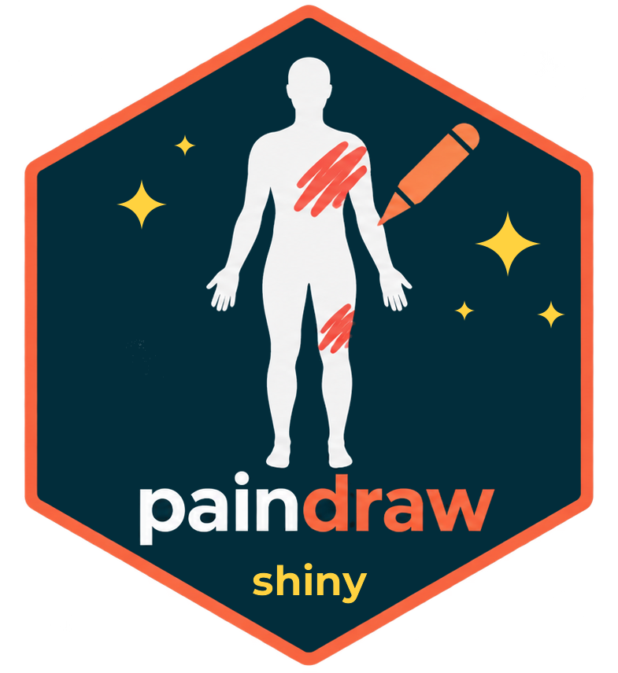
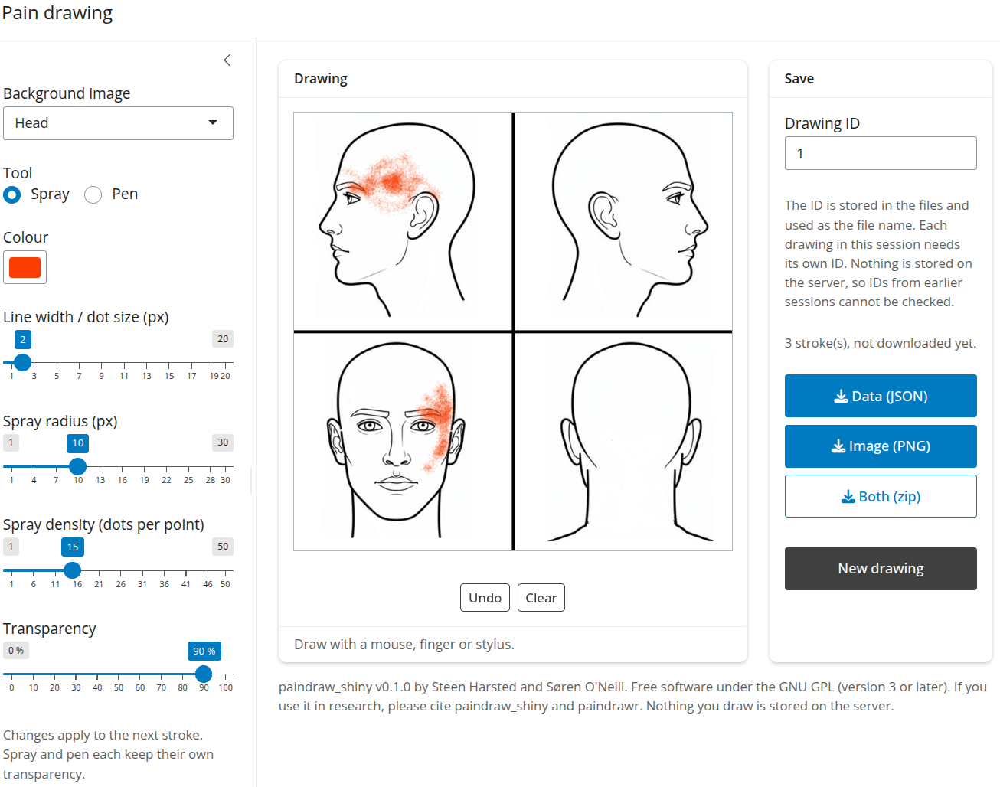

# paindraw_shiny 

A Shiny app for collecting pain drawings. The user draws on a background image and downloads the drawing as JSON (data) and PNG (image).

The JSON follows the format of the PainDrawEM REDCap external module, so drawings can be analysed with the R package paindrawr in the same way as REDCap data.

<br>

| Screenshot of the app |
|:--:|
|  |

<br>

## Run

```bash
git clone https://github.com/steenharsted/paindraw_shiny.git
```

```r
shiny::runApp("paindraw_shiny")
```

Dependencies are listed in `DESCRIPTION`: shiny, bslib, jsonlite, png, base64enc, zip.

<br>

## Layout

| Path | Contents |
|---|---|
| `app.R` | UI and server |
| `R/` | Plain R functions (sourced automatically by Shiny): backgrounds, validation, JSON payload, PNG, IDs, canvas module, UI strings |
| `www/js/paindraw_shiny.js` | The drawing canvas (port of PainDrawEM `js/paindraw.js`) |
| `www/backgrounds/` | Built-in `bg_*.png` images, copied from paindrawr |

Nothing is written to the server. Drawings exist only in the browser session and leave as downloads.

<br>

## How to cite

If you use paindraw_shiny in research, please cite it. See [CITATION.cff](CITATION.cff); a formal reference will be added when available. For analyses, please also cite paindrawr (<https://github.com/steenharsted/paindrawr>).

<br>

## Credits

The drawing code in `www/js/paindraw_shiny.js` is ported from the PainDrawEM REDCap external module (GPL-3; see its README for authors). The output format is the PainDrawEM JSON format.

<br>

## Licence

paindraw_shiny is free software: you can redistribute it and/or modify it under the terms of the GNU General Public License as published by the Free Software Foundation, either version 3 of the License, or (at your option) any later version. See [LICENSE](LICENSE).
